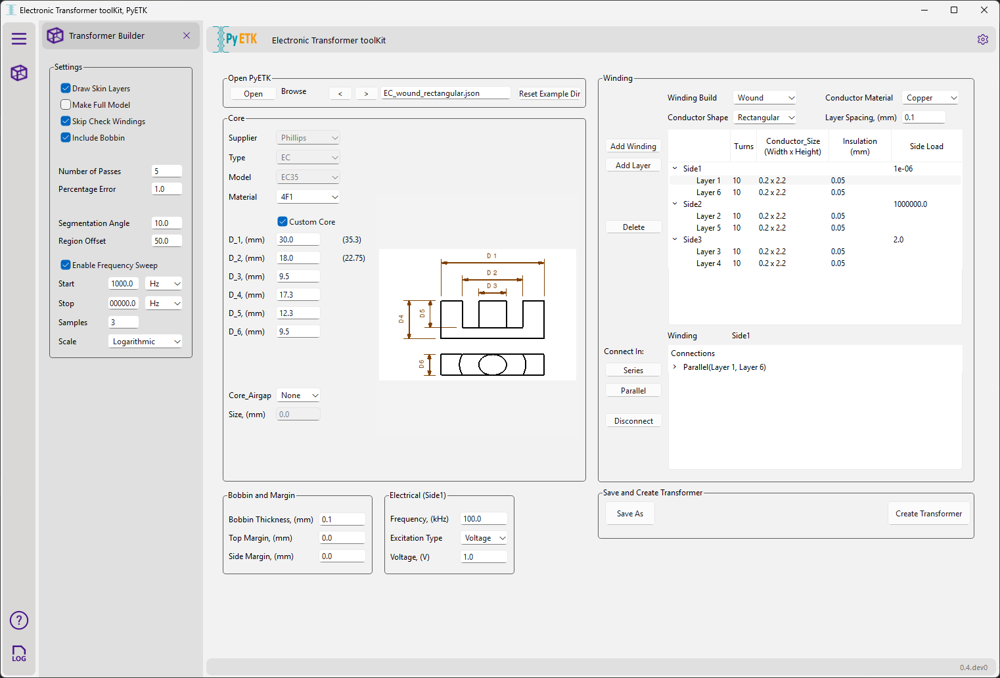

.. _transformer_builder:

**Transformer Builder** tab
===========================

In the UI's upper left corner, click the cube icon to display the **Transformer Builder** tab.

In this tab, specify transformer information:

- Core type
- Core dimensions
- Bobbin type
- Bobbin dimensions
- Winding data
- Excitation data

Conductor type is shared by the transformer. Select a winding side or one of its
layers to edit that side's conductor dimensions above the winding table. All
layers on a side share these dimensions; different sides can use different
dimensions. The selected side's load is also edited above the table.
When an imported file has different dimensions within a side, the
first layer's dimensions are used for that side.

Select **Round (Litz)** or **Rectangular (Litz)** to
model each turn as a round or rectangular bundle. Enter the bundle dimensions,
strand diameter, and strand count above the winding table for the selected side.
All layers on a side share
its strand specification; different sides can use different specifications.
The total strand cross-sectional area must not exceed the bundle area.
A planar transformer supports only the rectangular types, **Rectangular (Solid)**
and **Rectangular (Litz)**.

Litz strands are represented by Maxwell material properties, not individual
geometries. Each side's layers share one Litz material. PyETK disables
conductor eddy effects and does not create manual skin layers for Litz bundles.
For Litz designs, PyETK also creates a rectangular plot of ``StrandedLoss``
and ``StrandedLossAC`` versus frequency. Results are available after solving.
The Litz loss model assumes strand diameter is no
greater than the skin depth at the frequency of interest; choose strand dimensions
accordingly.

Save As exports the selected conductor type and its dimensions to JSON. Open
restores these settings for solid and Litz conductors with either bundle shape.
Existing JSON files using ``Rectangular``, ``Circular``, or ``Litz`` remain
supported; rectangular Litz is stored as ``Litz Rectangular``.

Use the **Settings** pane on the left side of the **Transformer Builder** tab to specify Maxwell analysis settings:

- Number of passes
- Percentage error
- Maximum number of passes
- Frequency sweeps
